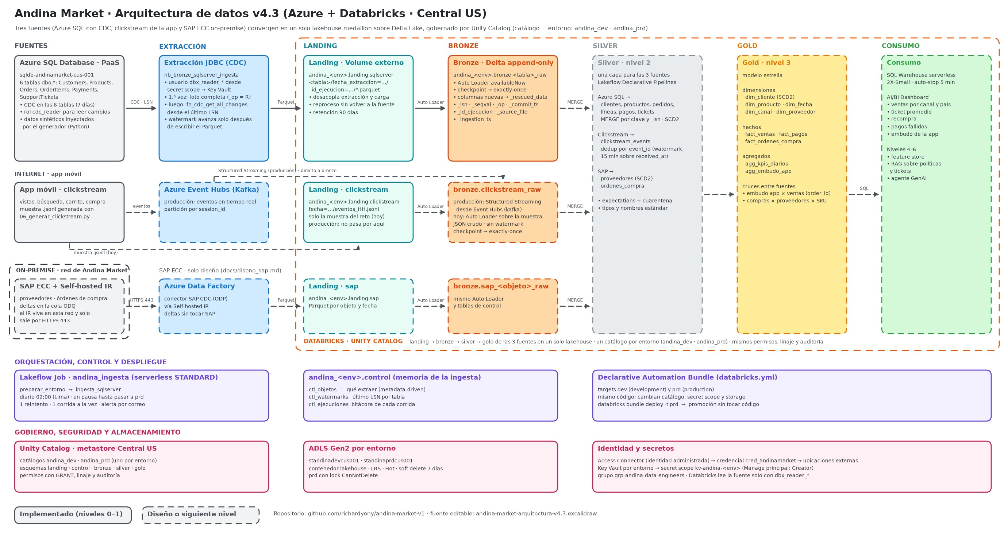
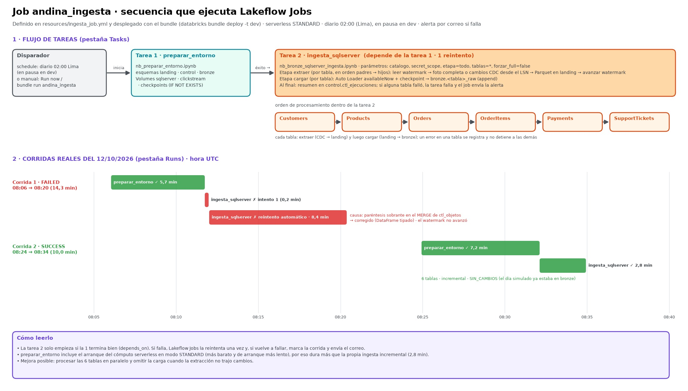

# Andina Market · Reto técnico AI Data Engineer

Plataforma de datos sobre **Azure + Databricks** para Andina Market, un retailer de e-commerce que opera en Latinoamérica. La operación transaccional vive en **Azure SQL Database**; los cambios se capturan con **CDC** y llegan a un lakehouse **medallion** gobernado por **Unity Catalog**, desplegado como código con un **Declarative Automation Bundle** y orquestado con **Lakeflow Jobs**.

## Hasta dónde llegué

| Nivel | Alcance | Estado |
|---|---|---|
| 0 · Fuente | Azure SQL con esquema propio, datos sintéticos inyectados en la base, CDC en las 6 tablas | ✅ |
| 1 · Ingesta | CDC → landing (Parquet) → bronze con Auto Loader; tablas de control; bundle dev/prd; job serverless | ✅ |
| 1 · Diseño | [Streaming del clickstream](docs/diseno_streaming.md) (Event Hubs + Structured Streaming) y [SAP ECC on-premise](docs/diseno_sap.md) (ADF + Self-hosted IR + SAP CDC) | ✅ |
| 2 · Transformación | Silver con calidad y SCD, gold dimensional | ⏳ siguiente |
| 3 a 6 | Gold + BI, feature store, RAG, agente | ⏳ |

Prioricé **profundidad en los niveles 0 y 1** antes de avanzar, como sugiere el reto.

---

## 1. Arquitectura



Fuente editable: [andina-market-arquitectura-v4.3.excalidraw](docs/arquitectura/andina-market-arquitectura-v4.3.excalidraw) (ábrela en excalidraw.com). Versión anterior, más detallada: [v3.1](docs/arquitectura/andina-market-arquitectura-v3.1.excalidraw). Línea continua: implementado; discontinua: diseño o siguiente nivel.

```
Azure SQL (sqldb-andinamarket-cus-001)                 Unity Catalog · <catalogo> = andina_dev | andina_prd
  dbo.* + CDC (cdc.fn_cdc_get_all_changes_*)
        │  JDBC · usuario de solo lectura (secret scope → Key Vault)
        │  foto completa la 1.ª vez · después, cambios desde el último LSN
        ▼
  /Volumes/<catalogo>/landing/sqlserver/<tabla>/fecha_extraccion=…/id_ejecucion=…/*.parquet
        │  Auto Loader (availableNow + checkpoint → exactly-once)
        ▼
  <catalogo>.bronze.<tabla>_raw      Delta append-only + _lsn, _seqval, _op, _commit_ts,
                                     _extract_ts, _id_ejecucion, _source_file, _ingestion_ts
  <catalogo>.control.ctl_objetos · ctl_watermarks · ctl_ejecuciones   (qué, hasta dónde, qué pasó)
        │
        ▼  (nivel 2) silver → gold
```

### Infraestructura (todo en Central US)

| Grupo de recursos | Recursos | Rol |
|---|---|---|
| `rg-andinamarket-sql-cus-001` | `sql-andinamarket-cus-001` / `sqldb-andinamarket-cus-001` (serverless, oferta gratuita) | Sistema origen (OLTP) |
| `rg-andinamarket-shared-cus-001` | Workspace `dbw-andinamarket-cus-001` (Premium) · Access Connector `dbac-andinamarket-cus-001` | Cómputo y gobierno compartidos |
| `rg-andinamarket-dev-cus-001` | ADLS Gen2 `standinadevcus001` · Key Vault `kv-andina-dev-cus-001` | Datos y secretos de dev |
| `rg-andinamarket-prd-cus-001` | ADLS Gen2 `standinaprdcus001` · Key Vault `kv-andina-prd-cus-001` · lock `CanNotDelete` | Datos y secretos de prd |

**Unity Catalog:** credencial `cred_andinamarket` (identidad administrada del Access Connector, sin claves) → ubicaciones externas `loc_andina_dev` / `loc_andina_prd` → catálogos `andina_dev` / `andina_prd`, cada uno sobre el storage de su entorno, con esquemas `landing`, `control`, `bronze`, `silver` y `gold`.

---

## 2. Decisiones de arquitectura

Cada decisión con su porqué y la alternativa que descarté.

| # | Decisión | Por qué | Alternativa descartada |
|---|---|---|---|
| D-01 | **Región única: Central US** | En la suscripción, East US y East US 2 tienen restringido el aprovisionamiento de Azure SQL (verificado con la API de capacidades). Una sola región evita costo de egress y latencia entre SQL, ADLS y Databricks | Separar regiones (SQL en una, Databricks en otra): egress y latencia sin beneficio |
| D-02 | **Grupos de recursos por responsabilidad y entorno** (sql, shared, dev, prd) | Aislamiento, permisos por entorno y costos filtrables por RG/tag | Un solo RG: mezcla ciclos de vida y permisos |
| D-03 | **Un workspace Premium híbrido, cómputo serverless por defecto** | Premium es requisito de Unity Catalog y serverless. Serverless no consume la cuota de vCPU (10 en la región) ni cobra máquinas paradas; el modo híbrido deja un cluster clásico como plan B | Workspace solo serverless (más nuevo, menos flexible); un workspace por entorno (duplica costo y operación; el aislamiento lo dan catálogo + storage) |
| D-04 | **Aislamiento dev/prd por catálogo y storage**, no por workspace | Cada catálogo tiene su propio ADLS y Key Vault; el mismo código cambia solo de variables | Esquemas dev/prd en un mismo catálogo: permisos y storage compartidos |
| D-05 | **CDC de SQL Server** en las 6 tablas | Captura INSERT, UPDATE (antes/después) y DELETE con **cada estado intermedio**: un pago que pasa `pendiente → aprobado → reembolsado` el mismo día deja las tres versiones. Un solo mecanismo y un solo tipo de watermark (LSN) | **Watermark por `UpdatedAt`:** no ve DELETE y depende de que la app actualice la columna. **Change Tracking:** más liviano, pero solo da el estado neto y pierde las transiciones de `Payments` |
| D-06 | **`fn_cdc_get_all_changes`** (no `net_changes`) | El historial completo de estados es justo lo que el reto pide cuidar en `Payments`; bronze guarda todo y silver decide | `net_changes`: solo el último estado por clave |
| D-07 | **CDC activado después de la carga inicial** | La primera ingesta es una foto completa (`_op = 'R'`) con el LSN máximo leído **antes** de la foto como watermark; desde ahí solo cambios. Así las tablas de cambios no se llenan con ~170 000 inserts históricos | CDC desde el inicio: tablas de cambios enormes sin valor |
| D-08 | **Landing en Parquet + Auto Loader** en lugar de JDBC directo a bronze | Desacopla la extracción de la carga: si falla bronze, los archivos siguen en landing y se reprocesan sin volver a leer la fuente. El checkpoint de Auto Loader da exactly-once | JDBC → bronze en un paso: un fallo obliga a reextraer y no hay registro físico de lo extraído |
| D-09 | **Watermark con LSN en tablas de control** (`control.ctl_*`), guiado por metadatos | `ctl_objetos` define qué extraer (agregar una tabla = una fila), `ctl_watermarks` hasta dónde y `ctl_ejecuciones` qué pasó. El watermark **solo avanza después de escribir el Parquet**, así una falla nunca pierde cambios | Watermark en archivos o variables del job: frágil y sin auditoría |
| D-10 | **Bronze append-only, sin limpiar ni deduplicar** | Bronze es el registro fiel de lo que llegó; la limpieza y el MERGE van en silver. Permite reconstruir silver desde cero | Deduplicar en bronze: se pierde la evidencia de lo recibido |
| D-11 | **Trazabilidad por fila** | `_lsn`, `_seqval`, `_op`, `_commit_ts` (origen y orden real del cambio), `_extract_ts`, `_id_ejecucion` (qué corrida), `_source_file`, `_ingestion_ts` (de qué archivo y cuándo entró) | — |
| D-12 | **Evolución de esquema en dos niveles** | **Databricks:** `schemaEvolutionMode = rescue`; una columna inesperada va a `_rescued_data` y la carga no se rompe. **Fuente:** con CDC, una columna nueva **no** entra en la capture instance existente; el procedimiento es crear una segunda capture instance, apuntar el extractor a ella y retirar la anterior (SQL Server admite dos por tabla) | `addNewColumns` en Auto Loader: incorpora la columna, pero detiene el stream una vez y altera bronze sin revisión |
| D-13 | **Lakeflow Jobs + Declarative Automation Bundle** | Todo el flujo vive en Databricks (linaje, monitoreo y permisos en un lugar). El bundle versiona el job y lo despliega igual en dev y prd | Azure Data Factory / Airflow: otra herramienta que operar sin ventaja para este alcance |
| D-14 | **Frecuencia diaria (02:00, hora de Lima)** | El negocio analiza el día anterior; la retención de CDC (7 días) deja 6 días de margen ante caídas. Migrar a más frecuencia es cambiar el cron | Cada hora o continuo: más costo sin necesidad del negocio |
| D-15 | **Credenciales en Key Vault + secret scope, usuario de solo lectura** | Databricks lee la fuente con un usuario con `db_datareader` y el rol `cdc_reader`; nunca con el administrador. Ninguna credencial está en el código ni en Git | Credenciales en el notebook o en variables del job |
| D-16 | **Control de costos** | SQL warehouse en 2X-Small, auto-stop 5 min y escalado 1/1; jobs serverless en modo STANDARD; schedules en pausa en dev | Valores por defecto: en una versión anterior el SQL warehouse explicó el 66 % del gasto |

---

## 3. Fuente: Azure SQL (nivel 0)

| Archivo | Qué hace |
|---|---|
| [fuentes/01_ddl_tablas.sql](fuentes/01_ddl_tablas.sql) | 6 tablas con PK, FK, CHECK e índices; fechas de **negocio** (`OrderDate`, `PaymentDate`) separadas de las de **auditoría** (`CreatedAt`, `UpdatedAt`), todas en UTC; triggers que mantienen `UpdatedAt` y protegen `CreatedAt`; rol `cdc_reader` |
| [fuentes/02_generar_datos_andina.py](fuentes/02_generar_datos_andina.py) | Genera datos sintéticos y los **inserta directamente en Azure SQL** (sin archivo intermedio). `--modo inicial`: 18 meses de historia. `--modo dia`: un día de operación con inserts, updates (incluidos pagos que cambian dos veces) y deletes |
| [fuentes/03_habilitar_cdc.sql](fuentes/03_habilitar_cdc.sql) | CDC en la base y en las 6 tablas, lectura restringida a `cdc_reader`, retención de 7 días |
| [fuentes/simular_dia.ps1](fuentes/simular_dia.ps1) | Ejecuta `--modo dia` pidiendo la contraseña sin mostrarla y borrándola al terminar |
| [fuentes/06_generar_clickstream.py](fuentes/06_generar_clickstream.py) | Muestra `.jsonl` del clickstream de la app, coherente con los clientes, productos y pedidos de la base. Muestra versionada: [sample_data/clickstream_app_events.jsonl](sample_data/clickstream_app_events.jsonl) (744 eventos de una hora; el día completo, 12 533 eventos en 24 archivos, está en el Volume `andina_dev.landing.clickstream`) |

**Volumetría de la carga inicial** ([log](fuentes/logs/inicial_20261010_162156.json)): 5 075 clientes · 400 productos · 40 000 pedidos · 78 945 líneas · 42 096 pagos · 6 000 tickets.

**Casos borde sembrados a propósito** (la fuente es permisiva; la calidad se resuelve en el lakehouse): clientes duplicados y emails con mayúsculas o espacios, ciudades mal escritas o nulas, teléfonos nulos, productos sin descripción, pedidos con varios intentos de pago, totales que no cuadran con sus líneas, pedidos sin líneas, tickets con cuerpo nulo, muy largos o con emojis. El generador además se autocontrola (ningún pago antes de su pedido, ninguna fecha futura, `UpdatedAt ≥ CreatedAt`).

---

## 4. Ingesta (nivel 1)

| Archivo | Qué hace |
|---|---|
| [databricks.yml](databricks.yml) | Bundle `andina_market`; targets `dev` (development) y `prd` (production). Solo cambian catálogo, secret scope y cuenta ADLS |
| [resources/ingesta_job.yml](resources/ingesta_job.yml) | Job `andina_ingesta` (serverless): `preparar_entorno` → `ingesta_sqlserver`; un reintento, una corrida a la vez, diario en pausa, alerta por correo si falla |
| [src/ingesta/nb_preparar_entorno.ipynb](src/ingesta/nb_preparar_entorno.ipynb) | Crea esquemas y Volumes con `IF NOT EXISTS`: respeta lo existente en dev y lo crea en prd |
| [src/ingesta/nb_bronze_sqlserver_ingesta.ipynb](src/ingesta/nb_bronze_sqlserver_ingesta.ipynb) | Extracción CDC → landing y carga Auto Loader → bronze, con tablas de control y bitácora |
| [src/validacion/nb_validacion_bronze_sqlserver.ipynb](src/validacion/nb_validacion_bronze_sqlserver.ipynb) | Comprueba la ingesta: filas por corrida, carpetas en landing y recorrido de estados de pagos |

**Lógica de extracción por tabla:**
1. Sin watermark, `forzar_full = true` o watermark más antiguo que el LSN mínimo que CDC conserva → **foto completa**.
2. Watermark igual al LSN máximo → **sin cambios**.
3. Si no → **incremental** desde el LSN siguiente al guardado hasta el máximo actual.

Un error en una tabla no detiene las demás: se registra en `ctl_ejecuciones` y el notebook falla al final para que el job alerte.

### Evidencia

Verificado con consultas sobre `andina_dev.bronze.*_raw` y `andina_dev.control.ctl_ejecuciones` (12/10/2026):

**Bronze cuadra exactamente con la fuente**, operación por operación:

| Tabla | Foto completa (`R`) | Insert (`I`) | Update (`U`) | Delete (`D`) | Log del simulador |
|---|---:|---:|---:|---:|---|
| Customers | 5 075 | 20 | 40 | – | 20 I · 40 U |
| Products | 400 | – | 18 | – | 18 U |
| Orders | 40 000 | 150 | 395 | – | 150 I · 395 U |
| OrderItems | 78 945 | 267 | – | 5 | 267 I · 5 D |
| Payments | 42 096 | 158 | 161 | – | 158 I · 161 U |
| SupportTickets | 6 000 | 27 | 39 | 2 | 27 I · 39 U · 2 D |
| **Total** | **172 516** | | **1 282 cambios** | | [log del día](fuentes/logs/dia_20261012_003146.json) |

- **Estados intermedios de pagos, en su orden real** (`_lsn`, `_seqval`): el pago 42213 aparece tres veces, `pendiente → aprobado → reembolsado`; el 42178 queda `pendiente → rechazado` y su reintento 42247 pasa `pendiente → aprobado`. Es lo que `Change Tracking` o un watermark por `UpdatedAt` habrían perdido.
- **Sin duplicados:** 0 filas repetidas para la misma clave, `_lsn` y `_seqval`.
**Secuencia del job y sus corridas reales** (flujo de tareas y línea de tiempo):



- **Job desplegado con el bundle en dev:** corrida exitosa (`preparar_entorno` y `ingesta_sqlserver`); las 6 tablas en incremental `SIN_CAMBIOS`, como corresponde después de haber ingerido el día simulado.
- **Idempotencia:** re-ejecutar sin cambios en la fuente no agrega filas (watermark sin datos nuevos + checkpoint de Auto Loader).
- **Manejo de errores:** la bitácora registra una primera corrida con error en las 6 tablas: una consulta escalar sin alias que SQL Server rechaza cuando Spark la envuelve en una subconsulta JDBC. Cada tabla registró su error sin detener las demás y el watermark no avanzó; corregido el alias, la siguiente corrida hizo la foto completa sin pérdidas.
- **Limitación conocida:** en las corridas previas a la versión 1.1 del notebook, la bitácora de la etapa `cargar` registró 0 filas aunque la carga fue correcta (el conteo usaba `recentProgress`, que en serverless llega vacío). Desde la 1.1 se cuenta como filas después − filas antes; los datos de bronze no se vieron afectados.

---

## 5. Cómo reproducir

**Requisitos:** suscripción de Azure, workspace de Databricks Premium con Unity Catalog, Databricks CLI, Python 3.12 y Microsoft ODBC Driver 18 for SQL Server.

1. **Infraestructura (portal o CLI):** los recursos de la tabla de la sección 1. En el firewall de Azure SQL, la IP del equipo que corre el generador y *Permitir servicios de Azure* (el serverless de Databricks no tiene IP fija).
2. **Unity Catalog:** Access Connector con *Storage Blob Data Contributor* sobre ambos storage; credencial `cred_andinamarket`; ubicaciones externas `loc_andina_dev` / `loc_andina_prd`; catálogos `andina_dev` / `andina_prd` con su managed location en `abfss://lakehouse@standina<env>cus001.dfs.core.windows.net/andina_<env>`.
3. **Secretos:** usuarios de solo lectura `dbx_reader_dev` / `dbx_reader_prd` en la base; sus credenciales como `sql-usuario` / `sql-password` en cada Key Vault; secret scopes `kv-andina-dev` / `kv-andina-prd` respaldados por ellos (*Manage principal: Creator*).
4. **Fuente:**
   ```powershell
   py -3.12 -m venv .venv; .\.venv\Scripts\Activate.ps1; pip install -r requirements.txt
   # 1) ejecutar fuentes/01_ddl_tablas.sql en la base vacía
   # 2) carga inicial (pide la contraseña del administrador por variables de entorno, ver .env.example)
   python .\fuentes\02_generar_datos_andina.py --modo inicial
   # 3) ejecutar fuentes/03_habilitar_cdc.sql
   ```
5. **Ingesta:**
   ```powershell
   databricks bundle validate -t dev
   databricks bundle deploy   -t dev
   databricks bundle run andina_ingesta -t dev      # 1.ª vez: foto completa
   .\fuentes\simular_dia.ps1                        # un día de cambios en la fuente
   databricks bundle run andina_ingesta -t dev      # incremental: solo los cambios
   ```
6. **Verificar:** abrir `src/validacion/nb_validacion_bronze_sqlserver.ipynb`, o consultar `andina_dev.control.ctl_ejecuciones`.

Promover a producción es `databricks bundle deploy -t prd`, sin cambiar código.

---

## 6. Supuestos

- **Datos sintéticos:** la empresa es ficticia; montos en **USD** y fechas en **UTC**. Países: Perú, Colombia, Ecuador, Bolivia y Chile.
- **Un workspace para dev y prd:** el aislamiento lo dan catálogo, storage y Key Vault por entorno. En una empresa grande habría un workspace por entorno.
- **Identidad de ejecución:** el bundle corre con el usuario que despliega. En producción real se usaría `run_as` con un service principal dedicado.
- **Red:** Azure SQL y ADLS con acceso público restringido por firewall y autenticación. En producción, Private Endpoints.
- **Redundancia:** storage LRS por costo; en producción, ZRS o GRS.
- **Streaming y SAP:** solo diseño, como pide el reto.

---

## 7. Uso de IA

Usé asistentes de IA en todo el proyecto, como permite el reto. Las decisiones, la validación de resultados y la revisión de cada pieza son mías.

- **Generador de datos, SQL de la fuente y notebooks de ingesta y validación:** los diseñé y construí con **Claude** (chat), y los revisé, ejecuté y ajusté yo contra la base y el workspace reales.
- **Claude Code** (asistente en VS Code): me guio en la creación de la infraestructura (que hice yo en el portal), verificó configuraciones y costos con Azure CLI y Databricks CLI, preparó el bundle y el job, organizó el repositorio y redactó la documentación a partir de mis decisiones.
- **Lo que detecté y corregí al revisar:** el job desplegado con el bundle falló por un paréntesis sobrante en un `MERGE` que en la ejecución manual no se había manifestado; se reemplazó por un DataFrame con esquema explícito. También se corrigieron rutas relativas de los logs de los generadores y un bundle de prd que inicialmente usaba una carpeta editable por todos los usuarios.

---

## Estructura del repositorio

```
databricks.yml                bundle (targets dev y prd)
resources/ingesta_job.yml     job de ingesta (Lakeflow Jobs)
fuentes/                      DDL, generador de datos, CDC, simulador de día, clickstream y logs de evidencia
sample_data/                  muestra .jsonl del clickstream de la app (una hora, con todos los casos borde)
src/ingesta/                  preparación del entorno e ingesta CDC → landing → bronze
src/validacion/               validación de la ingesta
docs/arquitectura/            diagrama de arquitectura
```
