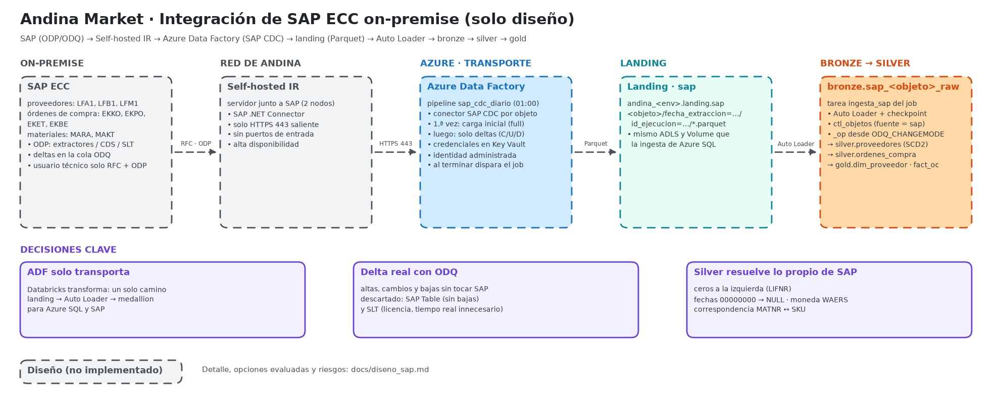

# Diseño: integración de SAP ECC on-premise

> **Solo diseño**, como pide el reto (nivel 1, extensión de diseño). No hay SAP ni datos de SAP en el proyecto.



Fuente editable: [andina-market-sap.excalidraw](arquitectura/andina-market-sap.excalidraw).

## 1. Qué hay que traer

Andina Market tiene en un **SAP ECC on-premise** el maestro de proveedores y las órdenes de compra. Las tablas estándar que los contienen:

| Objeto de negocio | Tablas SAP | Uso en el lakehouse |
|---|---|---|
| Proveedores | `LFA1` (datos generales), `LFB1` (por sociedad), `LFM1` (por organización de compras) | `silver.proveedores` → `gold.dim_proveedor` (SCD2) |
| Órdenes de compra | `EKKO` (cabecera), `EKPO` (posiciones), `EKET` (repartos), `EKBE` (historial: entradas de mercancía y facturas) | `silver.ordenes_compra` → `gold.fact_ordenes_compra` |
| Materiales (para cruzar con el catálogo) | `MARA`, `MAKT` | Tabla de correspondencia material SAP ↔ `SKU` de `dbo.Products` |

Con esto el negocio puede responder, por ejemplo: qué proveedor abastece los productos más vendidos, el plazo real de entrega frente al pedido, o qué compras están pendientes de recibir.

## 2. Opciones evaluadas

| Opción | Cómo funciona | Por qué sí o no |
|---|---|---|
| **ADF + conector SAP CDC + Self-hosted IR** ✅ | Azure Data Factory lee SAP con el framework **ODP** (extractores, vistas CDS o SLT como proveedor). La primera vez trae todo; después solo los **deltas** que SAP registra en su cola ODQ | **Elegida.** Conector nativo de Azure, delta real con altas, cambios y bajas, sin desarrollar en SAP ni comprar licencias adicionales, y encaja con el patrón landing → Auto Loader que ya existe |
| ADF + conector SAP Table | Lectura por RFC de tablas completas o con filtro por fecha | Sin delta confiable: no ve borrados y depende de columnas de fecha que no todas las tablas tienen; recargas pesadas sobre SAP |
| SAP SLT → destino en Azure | Replicación por triggers en la base de SAP, casi en tiempo real | Más latencia de la necesaria y requiere licencia y servidor SLT; se justifica si se necesita tiempo real |
| SAP Datasphere / Business Data Cloud + Delta Sharing con Databricks | Plataforma de datos de SAP que comparte con Databricks sin copias | Encaja con S/4HANA y la nube de SAP; para un ECC on-premise exige adoptar esa plataforma primero |
| Herramientas de terceros (Fivetran, Qlik Replicate) | Conectores administrados con CDC | Funcionan bien, pero suman costo por volumen y otro proveedor que gobernar |

## 3. Arquitectura propuesta

```
SAP ECC on-premise                    Red de Andina Market            Azure (Central US)
 LFA1, LFB1, LFM1 ─┐
 EKKO, EKPO, EKET ─┼─ ODP / ODQ ──▶ Self-hosted IR (2 nodos) ──HTTPS 443 saliente──▶ Azure Data Factory
 EKBE, MARA, MAKT ─┘   (RFC)          · SAP .NET Connector                         · pipeline sap_cdc_diario
                                      · sin puertos de entrada                     · flujo SAP CDC por objeto
                                                                                         │ Parquet
                                                                                         ▼
                              abfss://lakehouse@standina<env>cus001.dfs.core.windows.net/landing/sap/
                                <objeto>/fecha_extraccion=…/id_ejecucion=…/*.parquet
                                = Volume andina_<env>.landing.sap
                                                                                         │ ADF dispara el job
                                                                                         ▼
                              Lakeflow Job andina_ingesta · tarea ingesta_sap
                              Auto Loader (availableNow + checkpoint) → andina_<env>.bronze.sap_<objeto>_raw
                              ctl_objetos (fuente = 'sap') · ctl_ejecuciones
                                                                                         │
                                                                                         ▼
                              silver.proveedores (SCD2) · silver.ordenes_compra → gold
```

### Por qué así

- **Self-hosted Integration Runtime** en un servidor de la red de Andina Market, junto a SAP: es la pieza que permite a un servicio de Azure leer un sistema que no está expuesto a internet. **Solo abre conexiones salientes por HTTPS (443)** hacia Azure; no hay que abrir puertos de entrada en el firewall de la empresa. Con **dos nodos** hay alta disponibilidad. *Descartado:* exponer SAP con VPN hacia Databricks, que es más superficie de ataque y más trabajo de red.
- **ADF solo transporta; Databricks transforma.** ADF deja Parquet en el mismo **landing** que la ingesta de Azure SQL, y desde ahí es el mismo camino: Auto Loader, bronze append-only, tablas de control y medallion. Una sola forma de cargar, monitorear y gobernar, sin importar la fuente. *Descartado:* transformar en ADF (mapping data flows), que dividiría la lógica entre dos herramientas.
- **ADF dispara el job de Databricks** al terminar la extracción (actividad de job de Databricks, o un *file arrival trigger* del Lakeflow Job sobre `landing/sap/`). Así la carga empieza apenas hay datos, sin horarios encadenados a ciegas.
- **Reutiliza las tablas de control:** cada objeto de SAP es una fila en `ctl_objetos` con `fuente = 'sap'`. Agregar `EKBE` mañana es agregar una fila, igual que con Azure SQL.

## 4. Deltas y su equivalencia con CDC de Azure SQL

| Concepto | Azure SQL (implementado) | SAP ECC (diseño) |
|---|---|---|
| Registro de cambios en la fuente | CDC (tablas `cdc.*`) | Cola de deltas ODQ |
| Posición / watermark | LSN en `control.ctl_watermarks` | Lo administra el *subscriber* del conector SAP CDC en ADF (estado de la suscripción ODP) |
| Tipo de operación | `__$operation` → `_op` I/U/D | `ODQ_CHANGEMODE` (C/U/D) → mismo `_op` |
| Orden de los cambios | `_lsn`, `_seqval` | `ODQ_ENTITYCNTR` y la secuencia del request ODQ |
| Primera carga | Foto completa (`_op = 'R'`) | Carga inicial ODP (*full*), luego deltas |

Mantener **las mismas columnas técnicas** (`_op`, orden del cambio, `_id_ejecucion`, `_source_file`, `_ingestion_ts`) hace que silver aplique el mismo patrón de `MERGE` para ambas fuentes.

## 5. Particularidades de SAP que silver debe resolver

- **Ceros a la izquierda:** `LIFNR` llega como `0000012345`. Se normaliza para cruzar con otras fuentes, conservando el valor original.
- **Fechas vacías:** SAP usa `00000000` como "sin fecha": se convierten a `NULL`.
- **Montos y moneda:** los importes se interpretan junto con su moneda (`WAERS`); algunas monedas tienen otra cantidad de decimales en SAP.
- **Textos por idioma:** `MAKT` trae una fila por idioma; se filtra el idioma del negocio (ES).
- **Mandante (`MANDT`):** se filtra el mandante productivo.
- **Correspondencia de maestros:** el material de SAP (`MATNR`) no es el `SKU` de la tienda; una tabla de correspondencia mantenida por el negocio permite unir compras con ventas. Sin correspondencia, la fila queda marcada, no descartada.

## 6. Seguridad y gobierno

- **Usuario técnico en SAP** con permisos mínimos: RFC y lectura ODP de los extractores autorizados (objeto `S_RFC` y autorizaciones de ODP), sin acceso de diálogo.
- **Credenciales** del usuario SAP en el Key Vault del entorno, referenciadas desde el *linked service* de ADF con su identidad administrada.
- **ADF escribe en landing** con su identidad administrada y el rol *Storage Blob Data Contributor* limitado al contenedor del entorno.
- **Unity Catalog** gobierna bronze, silver y gold de SAP igual que el resto: permisos por grupo, linaje y auditoría. Los datos de contacto de proveedores (teléfono, email) con máscara de columna.

## 7. Frecuencia, monitoreo y costos

- **Frecuencia diaria** a la 01:00, después del cierre de procesos nocturnos de SAP y antes de la ingesta de Azure SQL de las 02:00. Las compras no necesitan tiempo real.
- **Monitoreo:** ADF alerta si la extracción falla; el Lakeflow Job alerta si la carga falla; `ctl_ejecuciones` registra filas por objeto para comparar con SAP.
- **Costos:**

| Pieza | Costo | Cómo controlarlo |
|---|---|---|
| Servidor del Self-hosted IR | Una VM pequeña on-premise o en Azure | Dos nodos solo en producción |
| ADF, flujo SAP CDC | Se cobra por vCore-hora mientras corre el flujo (mapping data flow) | Un pipeline diario que agrupa todos los objetos; TTL corto del cluster |
| Databricks | Minutos de serverless de la tarea `ingesta_sap` | Mismo job diario |

## 8. Riesgos y cómo mitigarlos

| Riesgo | Mitigación |
|---|---|
| Extractores ODP no habilitados para alguna tabla | Usar vistas CDS (si la versión lo permite) o SLT como proveedor ODP; validar con el equipo SAP Basis antes de construir |
| Carga inicial pesada sobre SAP | Programarla fuera de horario y particionarla por sociedad o año |
| Cambios de estructura en SAP (campos Z, ampliaciones) | Bronze tolera columnas nuevas (`_rescued_data`); se revisan antes de pasarlas a silver |
| Caída del Self-hosted IR | Dos nodos y alerta; la suscripción ODP conserva los deltas pendientes hasta la siguiente corrida |
