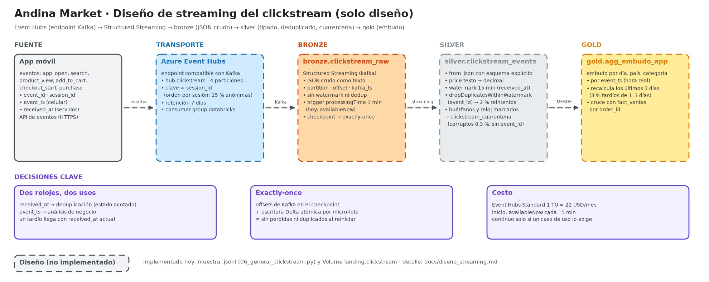

# Diseño: ingesta del clickstream en tiempo real

> **Solo diseño**, como pide el reto (nivel 1, extensión de diseño). Lo implementado es la muestra `.jsonl` que generaría la app ([fuentes/06_generar_clickstream.py](../fuentes/06_generar_clickstream.py)) y el Volume `andina_<env>.landing.clickstream` donde se deposita.



Fuente editable: [andina-market-streaming.excalidraw](arquitectura/andina-market-streaming.excalidraw).

## 1. Qué llega y qué problemas trae

Cada evento es un JSON con `event_id`, `event_type` (`app_open`, `search`, `product_view`, `add_to_cart`, `remove_from_cart`, `checkout_start`, `purchase`), `event_ts` (hora del celular, con su zona), `received_at` (hora del servidor), `session_id`, `customer_id`, `device_id`, `platform`, `app_version`, `country` y campos según el tipo (`product_id`, `price`, `order_id`, …).

La muestra siembra los problemas que tendría el flujo real, y cada uno condiciona una decisión:

| Caso en la muestra | Proporción | Decisión que provoca |
|---|---:|---|
| Mismo `event_id` reenviado (reintento de la app), llega 30 s a 10 min después | 2 % | Deduplicar por `event_id` con estado acotado (sección 4) |
| Evento de 1 a 3 días atrás (celular sin conexión) | 3 % | **No** descartar tardíos en bronze; recalcular agregados recientes (sección 4) |
| `customer_id` nulo (navega sin iniciar sesión) | 15 % de sesiones | No es error: se analiza por `session_id` / `device_id` |
| Campo nuevo `campaign` (solo la versión 3.5.0 de la app) | ≈ 6 % | Bronze guarda el JSON crudo; el esquema evoluciona en silver |
| `price` como texto (`"64.90"`) | 1 % | Parseo tipado en silver; lo que no castea va a cuarentena |
| `product_id` inexistente en el catálogo | 0,5 % | Se marca como huérfano en silver, no se descarta |
| Línea JSON truncada | 0,3 % | Cuarentena de registros corruptos, sin romper el stream |
| `event_ts` adelantado frente a `received_at` | 1 % | Corrección o marca del reloj del dispositivo en silver |
| Compra con `order_id` real del canal `app` | — | Permite cruzar el embudo con `Orders` en gold |

## 2. Arquitectura propuesta

```
App móvil ──HTTPS──▶ API de eventos ──▶ Azure Event Hubs (endpoint Kafka)
                                         · 1 event hub "clickstream", 4 particiones
                                         · clave de partición = session_id
                                         · retención 7 días · consumer group "databricks"
                                                │
                                                ▼  Structured Streaming (lector Kafka)
                     andina_<env>.bronze.clickstream_raw     JSON crudo + metadatos de Kafka
                                                │  trigger processingTime · checkpoint
                                                ▼
                     andina_<env>.silver.clickstream_events  parseado, tipado, deduplicado
                     andina_<env>.silver.clickstream_cuarentena
                                                │
                                                ▼  batch diario (MERGE) o vista materializada
                     andina_<env>.gold.agg_embudo_app        embudo por día, canal, país, categoría
                     (cruce con gold.fact_ventas por order_id)
```

**Por qué Event Hubs:** es el servicio administrado de Azure para ingesta de eventos y expone un **endpoint compatible con Kafka**, así que Databricks lo lee con el conector Kafka estándar y la app (o una futura migración a Kafka/Confluent) no cambia el contrato. *Descartado:* operar Kafka propio (HDInsight o en VMs), que agrega administración sin necesidad a este volumen.

**Por qué particionar por `session_id`:** conserva el orden de los eventos de una sesión dentro de su partición y reparte la carga. *Descartado:* `customer_id`, porque el 15 % de las sesiones es anónima (`null`) y concentraría esos eventos en una sola partición.

## 3. Capa por capa

### Bronze: recibir todo, sin interpretar

```python
raw = (spark.readStream.format("kafka")
    .option("kafka.bootstrap.servers", "<namespace>.servicebus.windows.net:9093")
    .option("subscribe", "clickstream")
    .option("kafka.security.protocol", "SASL_SSL")
    .option("kafka.sasl.mechanism", "PLAIN")
    .option("kafka.sasl.jaas.config", dbutils.secrets.get("kv-andina-prd", "eventhubs-jaas"))
    .option("startingOffsets", "earliest")
    .load())

(raw.select(F.col("value").cast("string").alias("json_crudo"),
            "partition", "offset", F.col("timestamp").alias("kafka_ts"),
            F.current_timestamp().alias("_ingestion_ts"))
    .writeStream
    .option("checkpointLocation", "/Volumes/andina_prd/bronze/checkpoints/clickstream/checkpoint")
    .trigger(processingTime="1 minute")
    .toTable("andina_prd.bronze.clickstream_raw"))
```

- **El JSON se guarda como texto.** Así ningún cambio de esquema (como `campaign`) ni una línea corrupta detiene el stream: bronze es el registro fiel de lo que llegó.
- **`partition` y `offset`** dan trazabilidad exacta hasta el mensaje de Event Hubs, y permiten reprocesar desde un punto.
- **Sin watermark ni deduplicación:** bronze es solo append; los eventos tardíos y duplicados se conservan para que silver decida.

### Silver: interpretar, deduplicar y aislar lo malo

```python
eventos = (spark.readStream.table("andina_prd.bronze.clickstream_raw")
    .withColumn("e", F.from_json("json_crudo", esquema_eventos, {"mode": "PERMISSIVE",
                                                                 "columnNameOfCorruptRecord": "_corrupto"}))
    .select("e.*", "partition", "offset", "_ingestion_ts")
    .withColumn("received_at", F.to_timestamp("received_at"))
    .withColumn("event_ts", F.to_timestamp("event_ts"))
    .withColumn("price", F.col("price").cast("decimal(12,2)")))   # "64.90" → 64.90

validos = (eventos.filter("_corrupto IS NULL AND event_id IS NOT NULL")
    .withWatermark("received_at", "15 minutes")
    .dropDuplicatesWithinWatermark(["event_id"]))
```

- **Esquema explícito** (`esquema_eventos`) con `campaign` como columna opcional. Un campo desconocido nuevo se detecta comparando contra `_rescued_data` o el JSON crudo, y se agrega al esquema con revisión.
- **Cuarentena:** las filas con `_corrupto`, sin `event_id` o con `price` que no castea van a `silver.clickstream_cuarentena` con el motivo. No se descarta nada en silencio.
- **Huérfanos y reloj adelantado:** columnas `es_producto_huerfano` (sin match en `silver.productos`) y `event_ts_corregido` (si `event_ts` supera a `received_at` por más de 2 minutos, se usa `received_at` y se marca).

## 4. Watermark: la decisión clave

Hay dos relojes y cada uno sirve para algo distinto:

| Reloj | Qué mide | Uso |
|---|---|---|
| `received_at` | Cuándo llegó al servidor | **Deduplicación en streaming** |
| `event_ts` | Cuándo ocurrió en el celular | **Análisis de negocio** (embudo por hora o día) |

- **Deduplicación con watermark de 15 minutos sobre `received_at`.** Los duplicados de la muestra llegan entre 30 s y 10 min después del original, así que 15 minutos los cubre con margen. El estado que guarda Spark queda acotado a 15 minutos de `event_id`.
- **¿Por qué no sobre `event_ts`?** El 3 % de los eventos ocurrió entre 1 y 3 días antes. Un watermark de minutos sobre `event_ts` los descartaría; uno de 3 días mantendría en memoria el estado de 3 días de eventos. En cambio, un tardío llega con `received_at` actual: entra sin problema y conserva su `event_ts` original para el análisis.
- **Agregados de gold por `event_ts`:** como los tardíos pueden tocar hasta 3 días atrás, el embudo de gold se recalcula en batch para **los últimos 3 días** con `MERGE` (o como vista materializada). Así nunca queda un día cerrado sin sus eventos tardíos, y no hace falta un estado de 3 días en streaming.
- **Trade-off explícito:** un watermark más largo da más completitud y más memoria y latencia; uno más corto, lo contrario. La separación anterior evita tener que elegir uno solo.

## 5. Trigger, checkpoint y exactly-once

- **Trigger `processingTime="1 minute"`** en producción: el equipo ve el embudo con un minuto de retraso. **Hoy, en batch:** el mismo código con `trigger(availableNow=True)` procesa lo pendiente y se apaga; es lo que ya usa la ingesta de Azure SQL con Auto Loader.
- **Checkpoint:** guarda los offsets de Kafka ya procesados y el estado de la deduplicación. Ante una caída, el stream retoma exactamente donde quedó.
- **Exactly-once de punta a punta:** la fuente es reproducible (Event Hubs retiene 7 días y los offsets están en el checkpoint) y el destino es idempotente (Delta confirma cada micro-lote de forma atómica). Un micro-lote nunca queda escrito a medias ni dos veces.

## 6. Migración desde lo que ya existe

La ingesta actual ya usa Auto Loader con `availableNow` y checkpoint. Pasar el clickstream a tiempo real es:

| Hoy (muestra) | Producción |
|---|---|
| `.jsonl` en `landing.clickstream` | Event Hubs |
| `readStream.format("cloudFiles")` | `readStream.format("kafka")` |
| `trigger(availableNow=True)` en el job | `trigger(processingTime="1 minute")` en un job continuo |
| Mismo checkpoint, mismas tablas bronze/silver, mismas reglas | — |

Con **Lakeflow Declarative Pipelines** las mismas tablas se declararían como *streaming tables* con expectations para la cuarentena, y el pipeline elegiría el modo `triggered` o `continuous` sin cambiar el código.

## 7. Seguridad, gobierno y monitoreo

- **Credenciales:** la cadena de conexión de Event Hubs (o su JAAS) en el Key Vault del entorno, leída con el secret scope `kv-andina-<env>`; en una empresa, identidad administrada con un *service credential* de Unity Catalog, sin secretos.
- **Datos personales:** `customer_id` y `device_id` con acceso restringido en silver (máscaras de columna de Unity Catalog para quien no los necesita).
- **Monitoreo:** retraso de los consumidores en Event Hubs, duración y filas por micro-lote (`StreamingQueryListener`), y alerta si la cuarentena supera un umbral (por ejemplo, más del 1 % de eventos corruptos en una hora).

## 8. Costos

| Pieza | Costo aproximado | Cómo controlarlo |
|---|---|---|
| Event Hubs Standard, 1 unidad de procesamiento | unos 22 USD/mes | Suficiente para miles de eventos por segundo; escala con auto-inflate solo si hace falta |
| Stream continuo en Databricks | Cobra 24/7 | Si el negocio tolera 15 minutos de retraso: `availableNow` cada 15 minutos en un job programado, que solo cobra mientras corre |
| Gold recalculado 3 días | Minutos al día | Batch en el job diario |

**Recomendación para Andina Market:** empezar con `availableNow` cada 15 minutos (casi tiempo real a costo de batch) y pasar a `processingTime` continuo solo si un caso de uso lo exige (por ejemplo, recomendaciones en la sesión).
